

  <picture>
    <source media="(prefers-color-scheme: dark)" srcset="assets/mark-dark.png">
    
  </picture>

<h1 align="center">ZKBLANK</h1>

<b>Every buy leaves from a wallet that lives once.</b>

  A privacy rail for trading on Robinhood Chain. Fund a private balance from any chain, 
  then trade through <i>blanks</i>: fresh wallets that retire after one position.

  <a href="https://zkblank.tech">Website</a> ·
  <a href="https://app.zkblank.tech">App</a> ·
  <a href="https://zkblank.tech/docs">Docs</a> ·
  <a href="https://x.com/zkblankRH">X @zkblankRH</a>

  
  
  
  

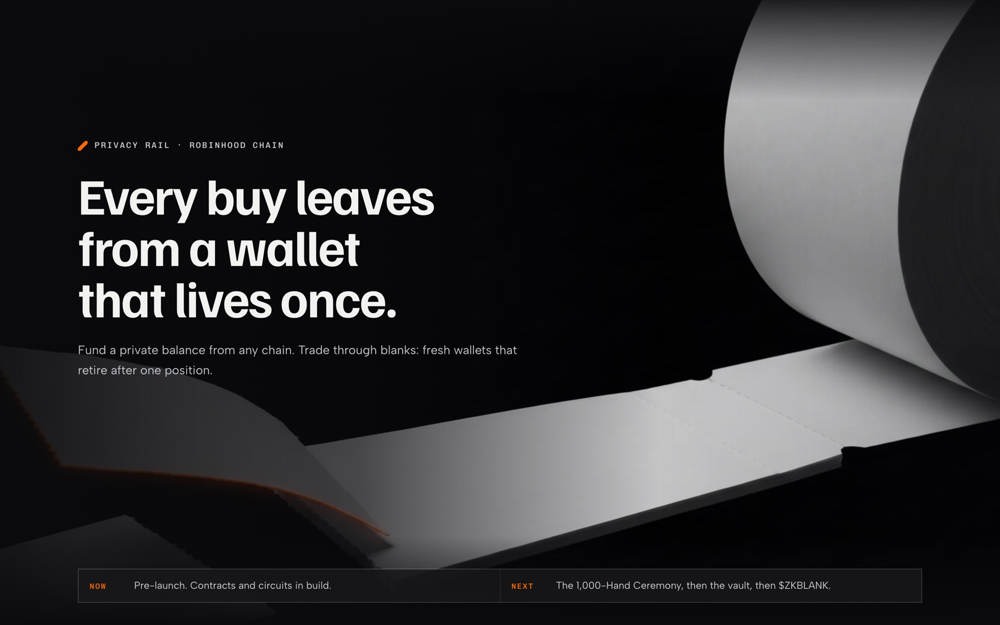

---

## About

Robinhood Chain is a glass room. Every wallet is public, and every buy shows up within about 100 ms. Copy-trading bots mirror size wallets within a block, trackers tag them for good, and every sell becomes a signal the whole chain can watch.

The usual fix does not work. A fresh wallet still needs a funding transaction, and that transaction points straight back to you.

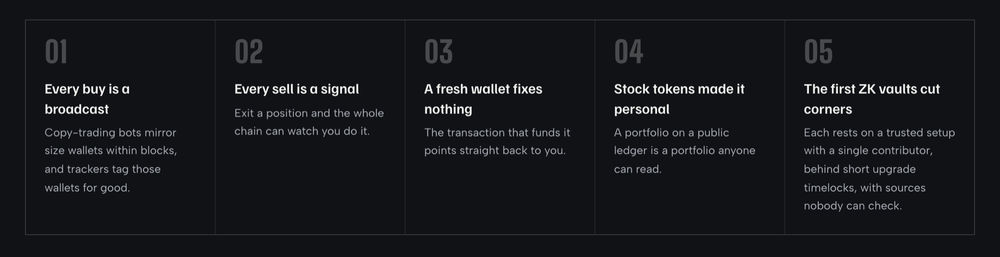

**ZKBLANK** is a zero-knowledge vault on Robinhood Chain where every buy is signed by a one-life wallet.

- Your money lives inside the vault as **private notes**. Only your browser can see the balance.
- Every buy goes out through a **blank**: a wallet with no code, no balance and no history, paid inside a zero-knowledge proof, so there is no funding transaction to follow.
- Every sell comes **back into the vault** as a fresh note, and the blank retires for good.

An observer sees that a blank bought a token and later sold it. An observer does not see where the buy money came from, or where the proceeds go next.

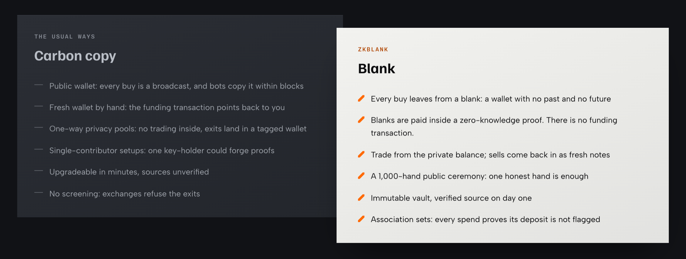

> **Privacy on a trading chain is an edge, not a hiding place.** The trade nobody can see is the trade nobody can copy. Keep the balance in the dark, send every buy out through a blank, bring every sell back in, and grow the crowd until a blank could belong to anyone.

### Where it stands

ZKBLANK is pre-launch, and the order is fixed: **contracts and circuits, then the 1,000-Hand Ceremony, then the vault, then $ZKBLANK.** The product goes live before the token does.

| Works today at [app.zkblank.tech](https://app.zkblank.tech) | Opens after the ceremony |
|---|---|
| **Carbon copy check:** grade any wallet by what the chain already shows about it | **Dark Drop:** money in from any chain |
| **Hand pre-registration:** reserve a place in the setup ceremony | **Burner Mode:** every buy from a fresh blank |
| **Waitlist:** for traders, and for bot, wallet and agent builders | **Blanks, Crowd Meter, Crowd Fees, tiers** |

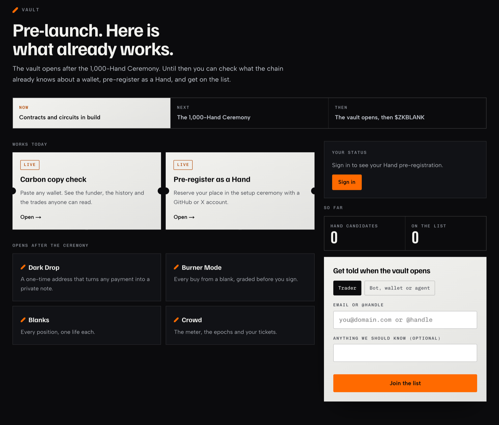

---

## Features

### 1. Dark Drop: money in, from anywhere

Your browser makes a drop key that never leaves the device and predicts a **one-time drop address** from it (CREATE2: nothing is deployed until money arrives). Pay it from any Robinhood Chain wallet, any bridge or intent rail from Solana, Base, Ethereum or Bitcoin, or an exchange withdrawal.

- **Swept by any keeper.** `sweep()` deploys the drop box, reads what arrived and computes the note commitment **on-chain** from the amount and your sealed key.
- **Screened.** The association-set provider checks the deposit's source. Clean deposits join the approved set, usually within the hour.
- **Private.** The chain knows a deposit happened. It never learns which later trade it pays for.
- **Assets at launch:** ETH, WETH and USDG.

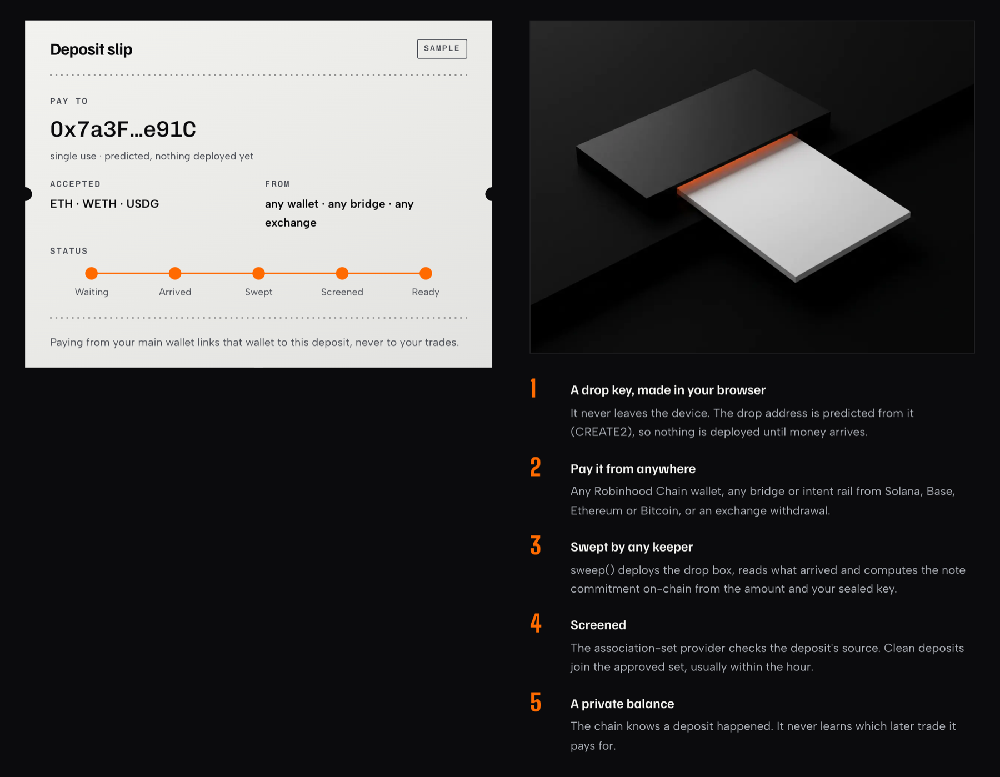

### 2. Burner Mode: every buy from a blank

A blank is a counterfactual smart account derived from your seed. It has no code, no balance and no history, it holds exactly one position, and a seed restore finds it again.

1. **Pick a token and a size.** The quote is computed in your browser from pool state, so no quote API sees the trade before it lands.
2. **Tear off the next blank.** Derived in the browser, never used before.
3. **Read the grade.** The Privacy Report Card scores the trade before you sign.
4. **Prove it.** Your browser proves, in zero knowledge, that you own enough unspent notes, that their deposits sit in the approved set, and exactly which swap to pay.
5. **Relayed.** A relayer submits the proof. The vault spends the notes, routes the swap and the tokens land in the blank. Change returns as a new private note.
6. **Held.** The blank was never sent gas and never touched your other wallets.

The proof binds the token, the minimum out, the recipient blank, the deadline and the relayer fee. Change any field and the proof fails: a relayer can carry the trade, it cannot edit it.

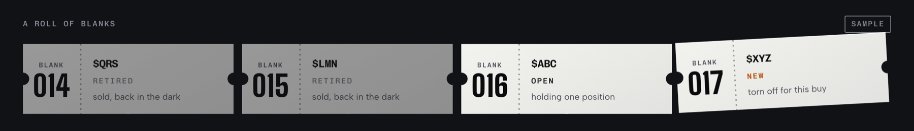

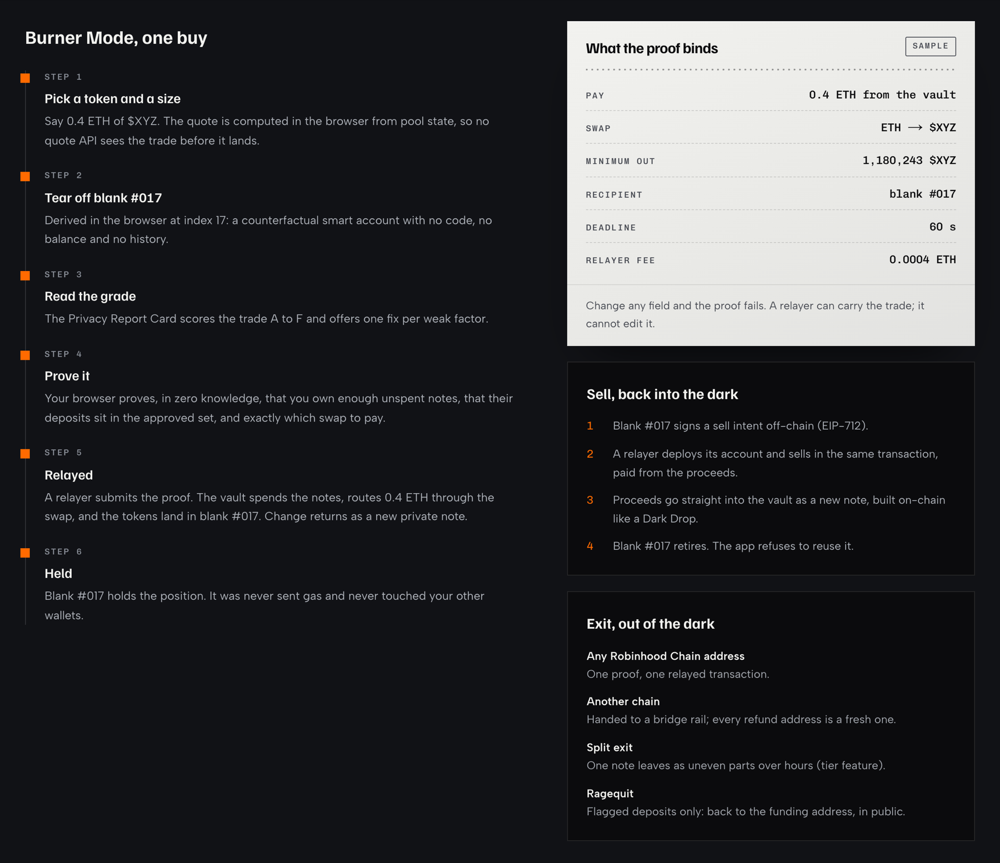

### 3. Sell back into the dark, and exit

- **Sell.** The blank signs a sell intent off-chain (EIP-712). A relayer deploys the blank's account and sells in the same transaction, paid from the proceeds. The proceeds go straight into the vault as a new note, and the blank retires. The app refuses to reuse it.
- **Exit to any Robinhood Chain address:** one proof, one relayed transaction.
- **Exit to another chain:** handed to a bridge rail, with a fresh refund address every time.
- **Split exit** (tier feature): one note leaves as uneven parts over hours, to blur amount and timing.
- **Ragequit:** for flagged deposits only, back to the funding address, in public.

### 4. What the chain sees, and what it never learns

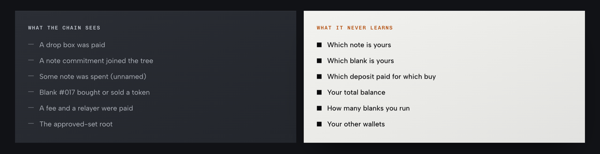

| Public | Hidden |
|---|---|
| a drop box was paid | which note is yours |
| a note commitment joined the tree | which blank is yours |
| some note was spent (unnamed) | which deposit paid for which buy |
| a blank bought or sold a token | your total balance |
| a fee and a relayer were paid | how many blanks you run |
| the approved-set root | your other wallets |

No single party sees both sides. The bridge sees the money coming in, never a blank. The relayer sees the trade, never the deposit. The indexer serves fixed public data with no parameters.

### 5. Privacy Report Card

Zero knowledge hides the link between a deposit and a trade. It cannot hide behaviour. So every trade gets a grade from **A to F** before you sign, computed in your browser from public data and never sent anywhere.

| Factor | Good | Risky |
|---|---|---|
| Cover | 1,000+ notes newer than yours | under 100 |
| Rest | 6 h+ since your deposit | under 30 minutes |
| Amount | a common round size | matches a recent deposit |
| Token crowd | many buyers today | you are the only one |
| Rail timing | drop older than 2 h | drop under 10 minutes |
| Holder band | off (whole crowd) | on (half the crowd) |

Every weak factor comes with one concrete fix: *wait 40 minutes*, *use 0.30 + 0.20*, *skip the discount*. The decision stays yours.

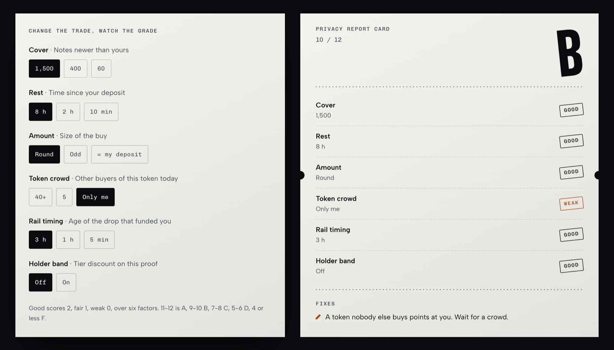

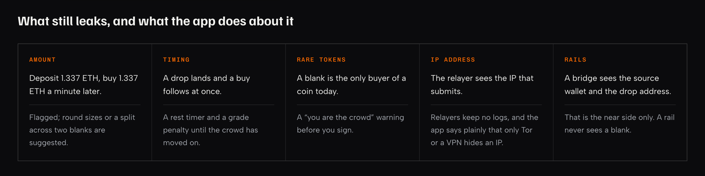

### 6. Carbon copy check (works today)

Paste any Robinhood Chain address and see what every copy-bot can already read about it. The check grades five factors, **history, funding trail, holdings, trading footprint and recent activity**, from *A: barely a trace* to *F: a full carbon copy*, and shows the same trade from a blank next to it.

The address is read from the public record, held in memory for one minute and written nowhere.

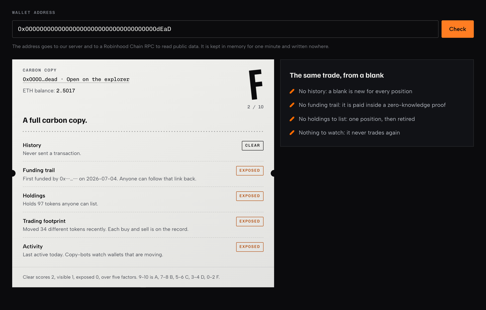

Shown: the public burn address. The funder's address is masked in this image.

### 7. Association sets: private, not a mixer

Every spend proves two things: **my note is in the vault**, and **my note's deposit is in the approved set**.

- The association-set provider (ASP) screens each new deposit against public sanctions lists and known exploit addresses, then posts the approved root.
- Approved deposits are spent privately as normal.
- Flagged deposits can only **ragequit**: back to the funding address, in public, at a 0% fee. They never join the crowd.
- Anyone can read and diff the approved set. A new provider waits 7 days, and later users choose between several providers.

The design follows Buterin, Illum, Nadler, Schär and Soleimani, *"Blockchain Privacy and Regulatory Compliance: Towards a Practical Equilibrium"* (2023). It keeps exits clean enough for exchanges and integrators to accept.

### 8. The 1,000-Hand Ceremony

Zero-knowledge proofs need a one-time setup, and whoever keeps that setup's secret could forge any proof. ZKBLANK's setup is built **in public by up to 1,000 people**. If even one of them destroys their secret, nobody can forge a proof. Not even us.

- **Contribute in your browser:** it downloads the latest key, adds fresh randomness, uploads the result and destroys its secret. About one to two minutes.
- **Get a receipt:** your contribution hash and position (#1 to #1,000) go into the public transcript, which anyone can verify.
- **Claim the Hand share:** 3% of supply, bought in the launch transaction at the opening price and split equally across verified Hands, claimable straight into a private note. Unclaimed shares burn after 60 days.
- **One Hand per GitHub or X account** older than 90 days. Contributions that fail the transcript check are struck from the record in public.

Pre-registration is open now at [app.zkblank.tech/hands](https://app.zkblank.tech/hands).

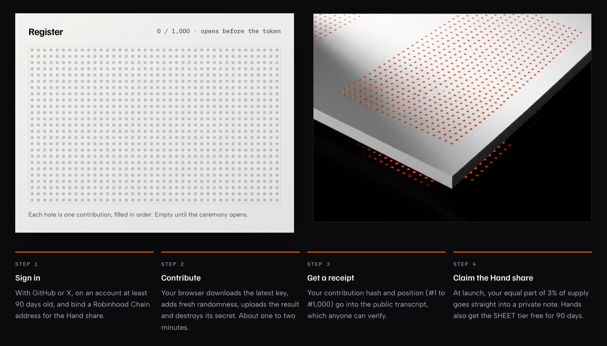

### 9. The Crowd: Crowd Meter and Crowd Fees

A blank is only as private as the crowd it hides in. Every note resting in the vault is cover for every other note, so ZKBLANK rewards the one habit that makes everyone safer: **waiting**.

**Crowd Meter.** Counts every note ever created, every spend and the rest times. It cannot count which notes are still unspent or how many people own them: one person with ten notes is ten notes, and the meter says so under the number.

**Crowd Fees.** Epochs last 24 hours.

1. Spend a note that rested at least one full epoch (minimum 0.02 ETH or 50 USDG).
2. The spend creates a private Crowd ticket, weight = epochs rested, capped at 7.
3. Each epoch's pot is $ZKBLANK bought with 30% of that epoch's fees.
4. Your share = pot × your weight / total weight, paid into a private note. Unclaimed tickets roll into the next pot after 30 epochs.

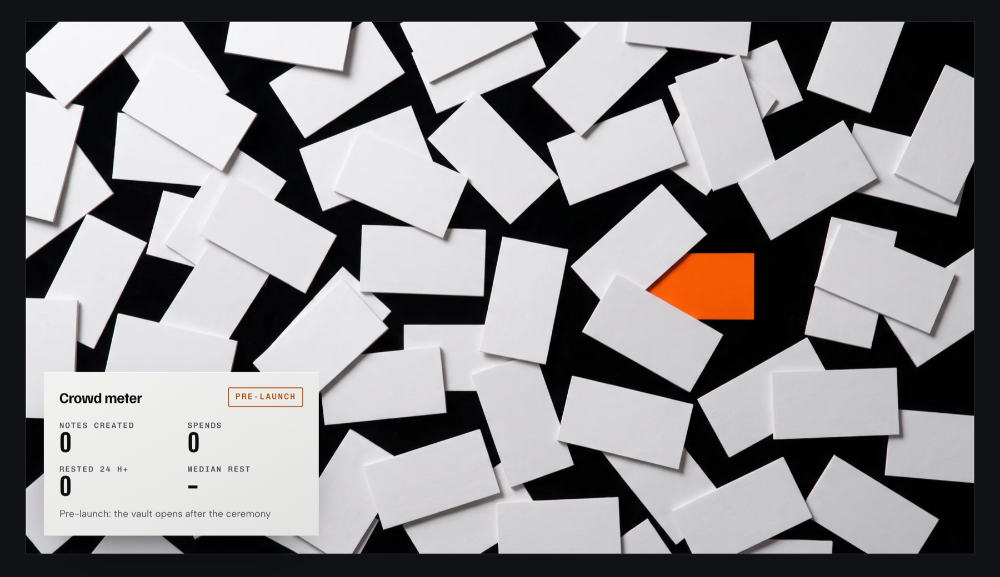

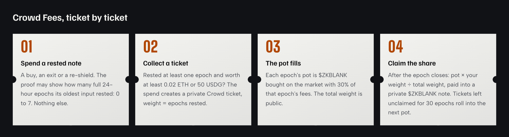

### 10. $ZKBLANK tiers: proven, never shown

A token sitting in a public wallet next to your blanks would undo the point. So you lock $ZKBLANK **inside the vault** as a time-locked note (30-day minimum), and a burner proof may carry one claim: *I own a locked note above the threshold, still locked.*

| Tier | Lock | Benefits |
|---|---|---|
| **BLANK** | 0 | Dark Drop, Burner Mode, sell back, exit, Report Card, Crowd tickets, burner fee 0.25% |
| **SHEET** | 1M (0.1% of supply) | Burner fee 0.15% (holder band), split exits up to 4 parts, API 10,000 calls a day |
| **STACK** | 5M (0.5%) | Everything in SHEET, Report Card Pro, scheduled sells, priority relaying, API 50,000 a day |
| **REAM** | 10M (1%) | Everything in STACK, split exits up to 12 parts, API 250,000 a day, a ceremony-2 seat |

On-chain it is **one bit**: standard or holder band. SHEET, STACK and REAM look identical. **The token buys price and convenience, never cover.** A tier-0 note is exactly as private as a whale's.

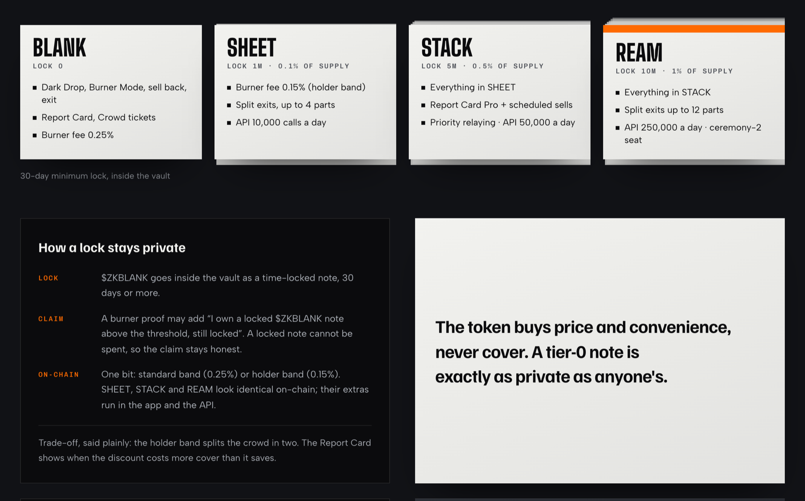

### 11. Fees, with a hard cap

Fees are taken inside the proof or the swap, in the asset being moved. No subscriptions, no accounts.

| Action | Fee |
|---|---|
| Dark Drop (money in) | 0.10% |
| Burner buy | 0.25% (0.15% holder band) |
| Sell back into the dark | 0.25% (0.15% holder band) |
| Re-shield (note to note) | 0.10% |
| Exit to an address or chain | 0.25% |
| Ragequit (flagged deposits) | 0% |
| Relayer gas | at cost + up to 10%, to the relayer |

**Hard cap in the contract: no fee can ever exceed 0.50%.** Changes inside the cap wait 7 days in a timelock.

Every fee, from every source, splits the same way: **35%** development and operations, **30%** Crowd Pot, **20%** buyback-and-burn $ZKBLANK, **10%** security fund, **5%** reserve.

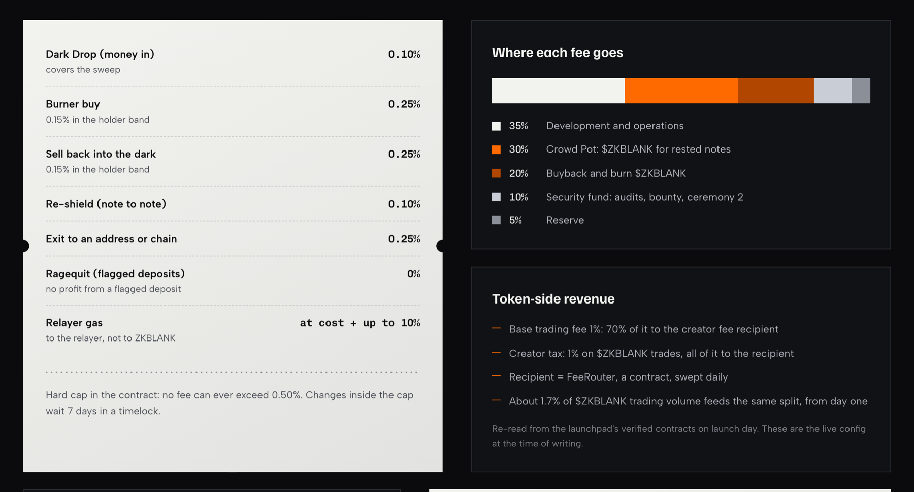

### 12. Built for bots, wallets and agents

- **Burner API + SDK:** the proof is built on the user's side, or in the integrator's own runtime, then relayed.
- **Bots:** every user's buy leaves from that user's own blank, so bot users stop being copy-traded as a group.
- **Wallets:** a Burner button next to Swap, with an integrator fee of up to 20% of the protocol fee, set on-chain.
- **Agents:** trade from a private balance and, later, publish proofs of results instead of trades (Proof-of-PnL).

Keys never leave the integrator's side. ZKBLANK sees proofs and public inputs only.

### 13. Security baseline

- **Immutable vault:** no owner, no proxy. Spends can never be paused; deposits can be paused during an incident.
- **Verified source** for every contract on deploy day, and a **7-day timelock** on every parameter.
- **Audits:** a delta audit of the forked circuits and contracts before mainnet, a second independent audit before caps rise.
- **Guarded launch:** max 5 ETH per note and a 500 ETH vault cap for the first 30 days.
- **Bug bounty** from testnet day one, paid from the security fund.
- **No accounts anywhere:** relayer requests carry no cookie, credential or account. The indexer stores public chain data only, never users, IPs or owners of notes.

---

## $ZKBLANK at a glance

| | |
|---|---|
| Total supply | 1,000,000,000 $ZKBLANK |
| Team allocation | 0 |
| Launch | 100% of supply on the Robinhood Chain launchpad curve, then graduation into a Uniswap pool, LP locked |
| Hand share | 3%, bought in the launch transaction at the opening price |
| Creator tax | 1%, to the FeeRouter |
| Contract | To be announced. The token launches after the vault. |

No emissions, no farm, no unlock schedule. Every buy and every burn traces back to a real trade through the vault.

## Roadmap

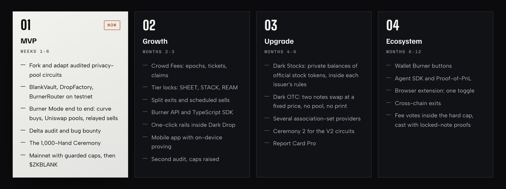

---

  <a href="https://zkblank.tech">zkblank.tech</a> ·
  <a href="https://app.zkblank.tech">app.zkblank.tech</a> ·
  <a href="https://zkblank.tech/docs">Docs</a> ·
  <a href="https://x.com/zkblankRH">@zkblankRH</a>

ZKBLANK is privacy software for lawful use. Deposits are screened, and flagged deposits can only return to their source. Zero-knowledge proofs hide the link between a deposit and a trade; they cannot hide behaviour. Amounts, timing, network addresses and token choice can still reveal a user, and no outcome is promised. Nothing here is financial, investment, legal or tax advice. $ZKBLANK is a utility token for access and fee settlement inside the product; it confers no ownership, rights or claims. Smart contracts and circuits can fail even after audits. Images are taken from zkblank.tech and app.zkblank.tech; cards marked "Sample" are illustrations until the vault opens.
